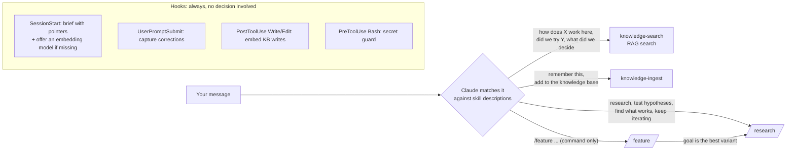
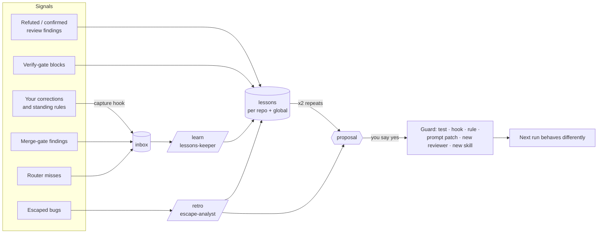
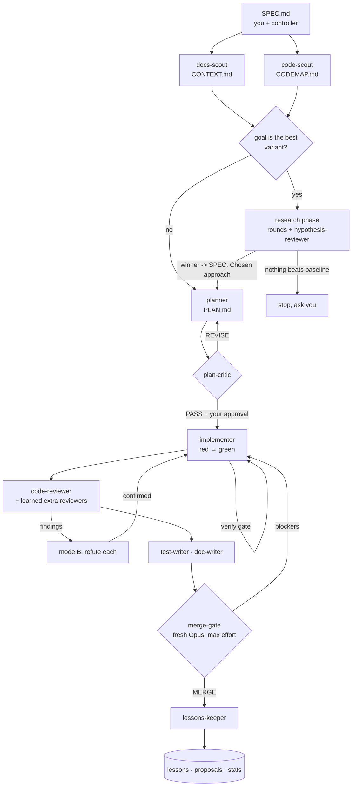
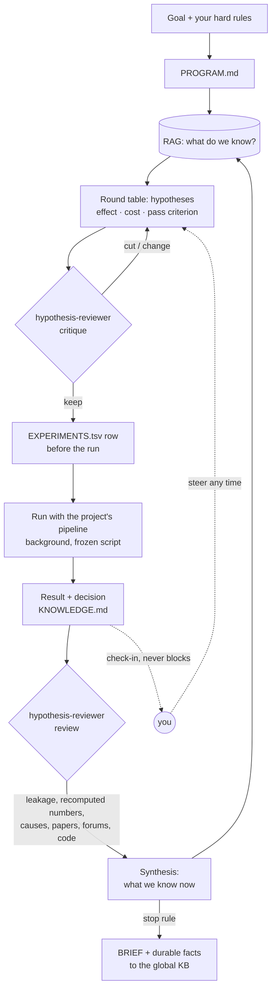
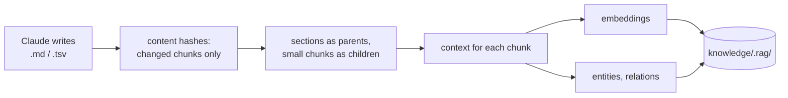
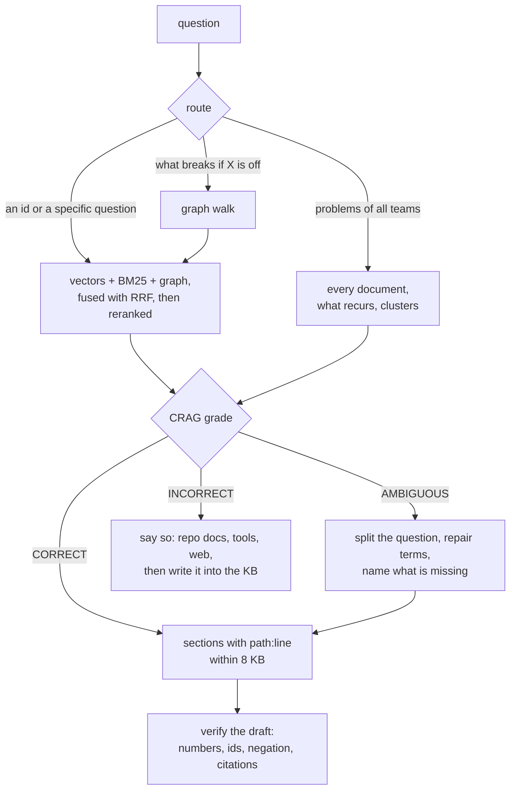

<div align="center">

# research-lab

**Missed a bug? research-lab grows a reviewer for it.**

A self-learning harness for Claude Code that turns escaped bugs, merge-gate findings and your corrections into evidence-backed lessons, regression tests and new reviewer agents.

[](https://github.com/nikserbur/research-lab/actions/workflows/ci.yml)
[](LICENSE)
[](CHANGELOG.md)
[](#install)

</div>

## Install

```text
/plugin marketplace add nikserbur/research-lab
/plugin install research-lab@research-lab
```

Restart Claude Code. The first session creates the data directory `~/.claude/research-lab/` (a git repo, so every lesson can be reverted). Prefer plain files in `~/.claude` instead of a plugin? Use the [install script](#install-script).

Then, in any repository:

```text
/knowledge-ingest repo                  # build a knowledge page for this repo and register it in the router
/feature "add CSV export"        # plan -> critique -> red test -> code -> review -> merge gate
/merge-check                     # fresh-context "can this be merged?"
/learn                           # turn captured feedback into lessons and proposals
/research "find a config that trades net positive"  # hypothesis -> test -> review -> KB -> next round
/skill-radar                     # what you have, what you keep doing by hand, what exists
```

## What it does

Claude Code forgets. You correct the same habit for the third time, a reviewer misses the same class of bug twice, and your `CLAUDE.md` grows until nobody reads it. research-lab closes that loop:

```text
you    > /retro the daily totals were wrong in prod: naive vs tz-aware datetimes in src/reports
claude > al-escape-analyst: the diff reached al-code-reviewer with the information, but nothing
         asked it to check time zones. First stage with info + mandate: code review.
         Proposed guards (cheapest first):
           1. regression test tests/reports/test_daily_tz.py  (fails on the buggy commit)
           2. new reviewer al-tz-reviewer, trigger: src/reports/**, "datetime"
         Apply? [apply / edit / reject]
you    > apply
claude > Added the test, ~/.claude/agents/al-tz-reviewer.md and an "Extra reviewers" row.
         /feature will now run al-tz-reviewer on every diff that matches.
```
<sub>Illustrative session. The proposal format is in [docs/examples/retro-proposal.md](docs/examples/retro-proposal.md).</sub>

- **Missed a bug? It grows a reviewer.** `/retro` finds the first pipeline stage that had the information to catch the defect and proposes the cheapest durable guard: a regression test, a hook, a rule, a prompt patch, or a new specialised reviewer agent that runs on matching diffs from then on.
- **Learns from outcomes, not just from chat.** Merge-gate findings, refuted and confirmed review comments, verify-gate blocks and escaped bugs become lessons for the repo they happened in, each with evidence.
- **Learns how you work.** A hook notices corrections ("no, use uv"), standing rules ("from now on..."), approvals and escaped-bug reports in 15 languages; `/learn` turns them into preferences, and your edits to drafted messages into a style file.
- **A knowledge base that decides for itself how to search (RAG).** Pages, research journals and reviews are indexed twice, as vectors and as an entity graph, and stay current chunk by chunk. Each question picks its own route, every result is graded before Claude relies on it, and what the base cannot answer is said out loud instead of guessed. Only the best 8 KB enter the context, each section with `path:line`.
- **Researches in rounds, not in one shot.** `/research` pre-registers hypotheses, has a fresh reviewer attack the plan and then the results (leakage, costs, recomputed numbers, root causes, papers, forums, local code), writes every conclusion to a research KB and derives the next round from it. Check-ins with intermediate results never block: you steer while it works.
- **Structures what it reads.** Docs, wiki pages, repos and tickets become topic and project pages on your machine, every fact with its source.
- **Knows what it is missing.** `/skill-radar` mines your sessions for repeated manual work and scouts official skills, plugin marketplaces and the MCP registry for trusted building blocks, or drafts a new skill.
- **You stay in charge.** Lessons are written automatically and shown to you after every run; anything that steers future runs beyond a lesson is a proposal that waits for your "yes".

<div align="center">

| 13 agents | 11 skills | 7 hooks | 6 helper scripts | 0 dependencies |
|:---:|:---:|:---:|:---:|:---:|
| model-routed roles | slash commands + auto-triggered | tested, stdlib Python | deterministic work out of the context | Python 3.9+ standard library |

</div>

## Philosophy

- **Evidence over impressions.** A lesson needs a quote, a `file:line` or a run artifact. Findings are tried, not trusted: a second reviewer tries to refute each one.
- **The cheapest guard that would have worked.** A test beats a hook, a hook beats a rule, a rule beats a prompt patch, and a new agent is the last resort.
- **Fresh eyes find what anchored eyes miss.** The critic, the reviewers and the merge gate never see the author's reasoning.
- **Context is a budget.** `CLAUDE.md` is a routing table, the session brief carries pointers, and heavy reading goes to subagents and scripts.
- **The human approves behavior changes.** The harness proposes; you decide.

## What starts by itself

You do not have to remember which skill to call. Claude Code shows Claude every skill's description and Claude picks the one that matches your request; hooks are code and always fire on their event.



| Component | Starts | How |
|---|---|---|
| `research` | by itself or `/research-lab:research` | description match |
| `knowledge-search`, `knowledge-ingest`, `colleague-message`, `pr-description` | by themselves | description match |
| `/feature` | only by command | `disable-model-invocation`: a many-agent run never starts by accident; it calls the research phase itself when the goal is "the best" |
| Hooks | always | Claude Code events, not model judgement |

Auto-invocation is the model's judgement: a request close to a description usually triggers it; the slash command always does.

## How it learns



A signal becomes a lesson only with evidence. A lesson seen twice becomes a proposal, and the proposal picks the cheapest guard that would have worked:

| Rung | Guard | When |
|---|---|---|
| 1 | Regression test in the repo | always proposed for an escaped bug |
| 2 | Deterministic hook | the rule is mechanically checkable |
| 3 | Rule line in a `CLAUDE.md` | a project or personal convention |
| 4 | Prompt patch for one agent | a stage had the information and the mandate but missed it |
| 5 | New specialised reviewer or new skill | a recurring defect class needs its own fresh-context pass, or a routine was requested 3+ times |

Contradicted lessons move to an archive and repo lesson files stay under 60 lines. More in [docs/learning-loop.md](docs/learning-loop.md).

## The /feature pipeline



| | light (default) | deep (`deep` or high risk) |
|---|---|---|
| Planner | Opus, read-only, up to 3 tasks | strongest model with fallback, up to 3 sandboxed experiments |
| Critique | 1 round | up to 3 (5 at high risk, two PASS in a row) |
| Review | 1 round; refutation if more than 3 findings | up to 3 rounds; every finding refuted |
| Merge gate | mandatory, up to 2 rounds | mandatory, up to 3 rounds |
| Research phase (search for the best only) | 1-2 rounds | up to 4 rounds, critique + review each |
| Lessons | on signals | always |

Artifacts (`SPEC.md`, `PLAN.md`, `PROGRESS.md`, `review/`) live in `~/.claude/research-lab/runs/`, so your repo only gets code, tests and docs. Team repositories get `/git-handoff` instead of agent commits. More in [docs/pipeline.md](docs/pipeline.md).

## The research loop



Everything lands in `research/<slug>/KB/`; the hook embeds it, so the next round, the reviewer and any future project retrieve it.

## Examples: how to ask

Any language works; the skills match on meaning.

```text
# research, explicit and guaranteed
/research-lab:research "find an options market-making strategy that is net positive after fees on two-week windows" rounds 5
/research-lab:research research/nifty-mm rounds 3        # continue an existing research folder

# research, in plain words (usually triggers it)
Audit what the previous model proposed, then test hypotheses on per-side markout prediction.
Work in rounds: hypothesis -> test -> review -> conclusions in the KB -> new hypotheses.
No positional short-vol strategies. Two-week windows only, our standard pipeline.

# a feature whose goal is "the best": /feature runs the research phase first
/feature "pick the fastest JSON parser for the ingest service and switch to it"

# a plain feature: no research phase
/feature "add CSV export to the reports page"

# ask the knowledge base (knowledge-search, RAG): the route is chosen for each question
What did we learn about the CatBoost training window? Did we try E07c?
What breaks if Redis goes down?                                  # walks the entity graph
What integration problems did all teams have in the third quarter?   # every document, what recurs

# store a fact (knowledge-ingest; the hook embeds it right away)
Remember: back-of-queue sells are toxic, about -0.03 per lot.
```

## Knowledge base, retrieval (RAG) and router

Writing is automatic and touches only what changed:



Reading is one command, routed per question:



There is nothing to choose. `kb_rag.py search <question>` works with no packages installed, and `kb_rag.py setup` adds an embedding model for all later runs (about 370 MB of downloads). Each technique decides when it applies:

| Technique | Applies when | With no packages | When more is available |
|---|---|---|---|
| Hybrid search (vectors + BM25, RRF) | every question; an id shifts the weight to BM25 | hashed vectors | multilingual model via `fastembed` or `sentence-transformers` |
| Decoupled chunking | a section is longer than a chunk; shorter ones stay whole. Search sees the small chunk, Claude gets its section | yes | |
| Contextual retrieval | every chunk | title, summary, heading path, the section's lead sentence | a small LLM writes the context (`RESEARCH_LAB_LLM`) |
| Late chunking | the model exposes token vectors and sees at least 256 tokens | off | turns itself on, for example with `BAAI/bge-small-en-v1.5` |
| Rerank | every non-exact question | built-in: coverage, proximity, phrase and literal match | cross-encoder; an English-only one sits out on other languages |
| GraphRAG, local | a relation question about a known entity | relations from patterns | an LLM adds relations |
| GraphRAG, global | a question about the whole base or a period, with 3+ documents | every document gets a voice, recurring terms, entity clusters, month, quarter and year filter. Always graded as a sample, never as complete | |
| Corrective RAG | every result is graded; correction runs only when it is not `CORRECT` | splits compound questions, repairs inflections and typos, names what is missing, shows the closest sections to read before leaving for repo docs and the web | the embedding model vouches for paraphrases |
| Faithfulness (Self-RAG) | `verify` on a draft with numbers or ids, or built on a partial result (a `knowledge-search` step) | numbers with units, ids, names, negation, citations; exit 1 on a failure | |
| Streaming / CDC | every write (hook), every search, `watch`, `events` | re-embeds changed chunks only, journals each change | |

| Independent set: 106 questions on notes the author had not seen | v0.2.3 | v0.3.0 | v0.3.1 |
|---|---:|---:|---:|
| 71 with one answer, no packages: top-1 / top-3 | 44 / 49 | 36 / 41 | 40 / 41, or 49 / 55 counting weak candidates |
| The same, MiniLM: top-1 / top-3 | 45 / 57 | 48 / 55 | 49 / 55, or 50 / 57 counting weak candidates |
| 84 answerable, graded `INCORRECT`: no packages / MiniLM | | 31 / 7 | 29 / 4 |
| `CORRECT` without the answer in the section: no packages / MiniLM | | 1 / 1 | 0 / 0 |
| 22 with no answer in the base, `INCORRECT`: no packages / MiniLM | 2 / 2 | 17 / 12 | 18 / 12 |
| Of those 22, graded `CORRECT`: no packages / MiniLM | | 1 / 1 | 0 / 0 |
| 8 multi-hop, documents found: no packages / MiniLM | 0.75 / 0.85 | 0.48 / 0.73 | 0.83 / 0.88 |
| 5 about the whole base, documents found: no packages / MiniLM | 0.19 / 0.19 | 0.40 / 0.35 | 0.36 / 0.35 |

That set comes from a fresh session asked to break v0.3.0. It reversed the author's own claims: without packages the release found less than the engine before it, and it answered made-up ids and nonsense with `CORRECT`. v0.3.1 fixes what it found and takes its tests as acceptance tests, but the fixes were tuned on that same set, so it is no longer blind. What is left is plain in the table: without a model a third of answerable questions are graded `INCORRECT`, though the closest sections are shown for Claude to read; a question about the whole base finds well under half of the relevant documents, so its answer is always labelled a sample. On 24 questions about this repo's docs (top-1 / top-3 / MRR): no packages 0.83 / 1.00 / 0.91, MiniLM 0.79 / 1.00 / 0.89, MiniLM plus cross-encoder 0.88 / 0.92 / 0.92. Run [`scripts/rag_eval.py`](scripts/rag_eval.py) on your own notes before you rely on these. More in [docs/knowledge-router.md](docs/knowledge-router.md).

`knowledge-ingest` never writes a page without a router entry, and `kb_lint.py` fails on any page the router cannot reach. Every page, and every research `KB/` folder, is indexed for retrieval.

```text
~/.claude/research-lab/knowledge/
├── topic-map.md          # the router: "## topic" blocks, up to 8 lines each
├── map/<area>.md         # second level, once the top map passes 25 KB
├── topics/<slug>.md      # distilled notes, every fact with its source
├── projects/<repo>.md    # one page per repository: purpose, layout, commands, conventions, pitfalls
├── required-docs.md      # checklists every task is checked against
├── .rag/                 # the index: meta.json, vectors.f32, changes.jsonl
├── .stream/              # documents received through `kb_rag.py events`
└── .router-log.tsv       # hits and misses, feeding /learn and knowledge-ingest
```

```markdown
## Payments: refunds
keywords: refund, chargeback, reversal, PAY-, stripe webhook
read first: topics/payments.md#refunds · projects/billing-api.md#webhooks
sources: https://wiki.example.com/refunds ✅ · docs/adr/0012-refunds.md ✅
updated: 2026-10-21
```

`kb_route.py refund webhook` returns the matching curated block, the exact line ranges and sizes of the sections to read, and `sed -n` commands that fit an 8 KB budget; anything larger goes to a subagent.

## What's inside

- **Agents (13, all prefixed `al-`):** docs-scout, code-scout, planner, plan-critic, implementer, test-writer, code-reviewer, doc-writer, merge-gate, lessons-keeper, escape-analyst, skill-scout, hypothesis-reviewer.
- **Skills (11):** `/feature`, `/research`, `/merge-check`, `/learn`, `/retro`, `/skill-radar`, `knowledge-search`, `knowledge-ingest`, `colleague-message`, `pr-description`, `git-handoff`.
- **Hooks (7):** secret guard on commits, feedback capture, session brief, knowledge-base auto-indexing, verify gate, test-output filter, planner guard.
- **Scripts (6):** knowledge retrieval (RAG), router and linter, lessons and proposals CLI, session miner, capability inventory.

Every component with its model, trigger and purpose: [docs/components.md](docs/components.md).

```text
~/.claude/research-lab/        your data, a git repo (runs/ and inbox/ are git-ignored)
├── knowledge/              topic map, topics, projects, required docs
├── lessons/                <repo>.md, global.md, pipeline.md, runs.tsv
├── style/                  messages.md
├── proposals/              pending / applied / rejected changes, with evidence
├── radar/                  capability reports
├── inbox/                  captured feedback signals
├── runs/                   pipeline artifacts per repo and task
└── feedback-patterns.json  feedback phrasings in 15 languages, yours to edit
```

## Install script

```bash
git clone https://github.com/nikserbur/research-lab.git
cd research-lab
./install.sh --dry-run            # see what it would do
./install.sh --with-claude-md     # install + add a routing table to ~/.claude/CLAUDE.md
```

If one of your own files has the same name as a research-lab skill, the installer stops before changing anything; `--force` replaces it, keeps a backup, and `./uninstall.sh` puts your original back. Hooks are merged into `settings.json` idempotently and uninstall moves files to a backup folder instead of deleting them. `--with-claude-md` adds only a routing table ([templates/CLAUDE.md](templates/CLAUDE.md)); a fuller personal example is in [docs/examples/CLAUDE.personal.md](docs/examples/CLAUDE.personal.md).

> [!NOTE]
> Use either the plugin or the install script, not both. Plugin agents cannot carry their own hooks, so in plugin mode the pipeline gates are registered in `hooks/hooks.json` and act only for `research-lab:al-*` agents. The install script uses agent-scoped hooks instead.

## Safety

- **Human-approved self-modification.** Agents write only to the data directory. Prompts, skills, settings, `CLAUDE.md`, pipeline rules and extra reviewers change only after you approve a proposal.
- **Lessons come from trusted text only:** your own messages and pipeline artifacts, never tool output or web pages, so injected instructions cannot persist.
- **No hook auto-approves anything.** Hooks deny with a reason and the fix, or stay silent.
- **Local and private.** No telemetry and no network calls from any hook or script, with two opt-ins you control: a first download of an embedding or reranking model you installed support for, and an LLM for richer index context. By default that LLM can only be an Ollama server on your own machine; sending notes to Claude needs `RESEARCH_LAB_LLM=claude`. The feedback hook stores short, secret-redacted excerpts on your disk only.
- **No supply-chain surprises.** `/skill-radar` reads and grades third-party skills and MCP servers but never installs them.
- **Reversible.** The data directory is under git, the installer backs up what it replaces, and the uninstaller moves instead of deleting.

See [SECURITY.md](SECURITY.md) and [docs/hooks.md](docs/hooks.md).

## Status and limitations

- **v0.3.1.** The hooks and scripts are covered by tests; the agent prompts come from daily use but have not been measured on a benchmark yet.
- **Claude Code only.** There are no adapters for Codex, Cursor or other hosts.
- **Feedback capture is regex-based.** It recognises common phrasings in 15 languages and misses paraphrases; `/learn` also reads the corrections in the current conversation.
- **Retrieval is strongest with an embedding model.** Without one (`kb_rag.py setup`) search is lexical plus hashed vectors: paraphrases are often missed and a question in another language than the notes finds nothing (0 of 5 in the benchmark). With one, such a question is still weak (2 of 5 in the top 3), so the output asks Claude to repeat it in the language of the notes. A search with a model takes 1-3 s and about 1 GB of memory on 10,000 chunks.
- **Questions about the whole base are a sample.** They find well under half of the relevant documents, and the answer says so.
- **Verified on real models:** `kb_rag.py setup` and `fastembed` with two embedding models and a cross-encoder. Checked only against stand-ins that follow their APIs: `sentence-transformers`, Ollama and `RESEARCH_LAB_LLM=claude`. Real people's notes have not been measured.
- **The graph reads stated relations.** Without an LLM, entities and relations come from patterns in English and Russian ([add a language](skills/knowledge-search/scripts/ragkit/lang.json)), so it follows "X depends on Y", not relations left implied.
- **Verdicts are heuristics.** `CORRECT` means the question's words stand together in the section, not that the section answers it. Claude still reads what it cites.
- **`verify` is a lexical check.** It catches wrong numbers and units, unknown ids and names, bad citations and claims the base does not hold. It misses what a sentence only implies and decisions superseded in another note, and it raises false alarms across languages and on paraphrases.
- **Every indexed folder joins every later search.** `kb_rag.py forget --root DIR` takes one out. Files over 2 MB are skipped.
- **No connectors are bundled.** `kb_rag.py events` takes changes from Confluence, Notion or anything else as JSON lines, but something has to send them.
- **Plugin-mode gates rely on `agent_type`** in the hook input; the install script does not.

## How it compares

The multi-agent plan -> review pipeline is common ground: superpowers, compound-engineering and ECC all ship one, and they are more mature. research-lab's bet is the loop that grows guards from verified misses: stage-level root cause of escaped bugs, reviewers with diff triggers, and a knowledge base that cannot hold unroutable pages. A dated, side-by-side comparison, including where others are ahead: [docs/comparison.md](docs/comparison.md).

## FAQ

<details>
<summary><b>Does it need any Python packages?</b></summary>
No. Hooks and scripts use the Python 3.9+ standard library only. Tests run with <code>python3 -m unittest</code>. If <code>fastembed</code> or <code>sentence-transformers</code> is installed, or after <code>kb_rag.py setup</code>, retrieval uses real embeddings and a cross-encoder by itself.
</details>

<details>
<summary><b>Will it overwrite my existing agents or CLAUDE.md?</b></summary>
No. If a file of yours has the same name, the installer stops before changing anything; <code>--force</code> replaces it, keeps a backup, and <code>./uninstall.sh</code> puts it back. The CLAUDE.md routing block is opt-in and fenced by markers so the uninstaller removes exactly that block.
</details>

<details>
<summary><b>What does the feedback hook store?</b></summary>
For prompts that match a feedback pattern: time, session id (so /learn can read your surrounding messages), project folder name, the matched kinds, and the first 280 characters with keys, passwords, tokens and URL credentials redacted, in <code>~/.claude/research-lab/inbox/feedback.jsonl</code> (git-ignored, never sent anywhere). Slash commands are skipped. Set <code>RESEARCH_LAB_CAPTURE=0</code> to turn it off.
</details>

<details>
<summary><b>Which languages does feedback capture understand?</b></summary>
English, Chinese, Spanish, Portuguese, Russian, Japanese, German, French, Korean, Italian, Turkish, Polish, Ukrainian, Dutch and Vietnamese. The patterns live in <code>~/.claude/research-lab/feedback-patterns.json</code> (seeded from <a href="templates/feedback-patterns.json">templates/feedback-patterns.json</a>); edit it, or set <code>"enabled": ["de", "fr"]</code> to use only some languages. Every language ships with examples that the tests check.
</details>

<details>
<summary><b>Where do my team's checklists go?</b></summary>
<code>~/.claude/research-lab/knowledge/required-docs.md</code>. The docs scout reads it on every task, the critic blocks on unclosed items, and the merge gate checks the result against it.
</details>

<details>
<summary><b>Do I need the strongest model for deep mode?</b></summary>
No. Deep mode asks for it and falls back to Opus automatically on a usage limit, recording the fallback in <code>PROGRESS.md</code>.
</details>

<details>
<summary><b>Can I keep the data somewhere else?</b></summary>
Hooks and scripts honour <code>RESEARCH_LAB_HOME</code>, but the skills' instructions assume the default <code>~/.claude/research-lab</code>; treat the variable as a testing aid.
</details>

## Contributing

New feedback phrasings, reviewer archetypes that `/retro` produced for you, and router improvements are the most useful contributions. See [CONTRIBUTING.md](CONTRIBUTING.md); run `python3 scripts/validate.py && python3 -m unittest discover -s tests` before a pull request.

## License

[MIT](LICENSE)

<sub>Topics: claude-code · claude-code-plugin · claude-skills · agent-skills · claude-code-hooks · subagents · multi-agent · self-learning · continual-learning · agent-memory · knowledge-base · rag · graphrag · hybrid-search · context-engineering · code-review · tdd</sub>
