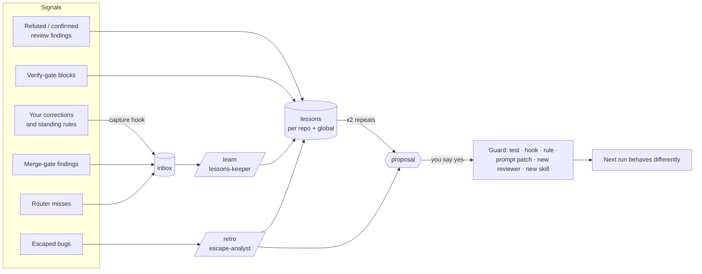
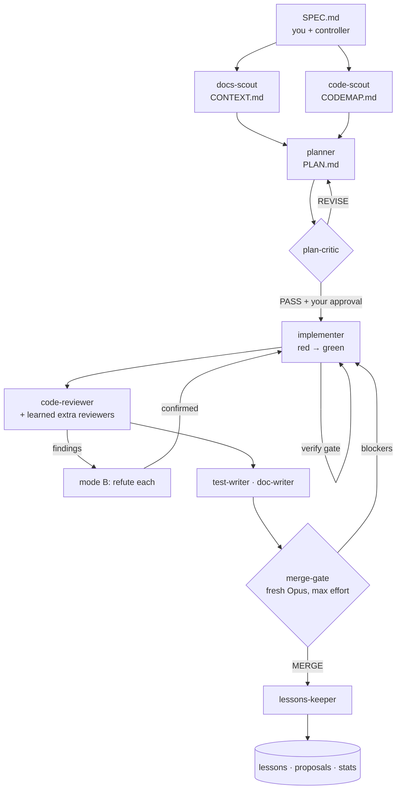

<div align="center">

# autolearn

**Missed a bug? autolearn grows a reviewer for it.**

A self-learning harness for Claude Code that turns escaped bugs, merge-gate findings and your corrections into evidence-backed lessons, regression tests and new reviewer agents.

[](https://github.com/nikserbur/autolearn/actions/workflows/ci.yml)
[](LICENSE)
[](CHANGELOG.md)
[](#install)

</div>

## Install

```text
/plugin marketplace add nikserbur/autolearn
/plugin install autolearn@autolearn
```

Restart Claude Code. The first session creates the data directory `~/.claude/autolearn/` (a git repo, so every lesson can be reverted). Prefer plain files in `~/.claude` instead of a plugin? Use the [install script](#install-script).

Then, in any repository:

```text
/kb-ingest repo                  # build a knowledge page for this repo and register it in the router
/feature "add CSV export"        # plan -> critique -> red test -> code -> review -> merge gate
/merge-check                     # fresh-context "can this be merged?"
/learn                           # turn captured feedback into lessons and proposals
/skill-radar                     # what you have, what you keep doing by hand, what exists
```

## What it does

Claude Code forgets. You correct the same habit for the third time, a reviewer misses the same class of bug twice, and your `CLAUDE.md` grows until nobody reads it. autolearn closes that loop:

```text
you    > /retro the daily totals were wrong in prod: naive vs tz-aware datetimes in src/reports
claude > al-escape-analyst: the diff reached al-code-reviewer with the information, but nothing
         asked it to check time zones. First stage with info + mandate: code review.
         Proposed guards (cheapest first):
           1. regression test tests/reports/test_daily_tz.py  (fails on the buggy commit)
           2. new reviewer al-tz-reviewer, trigger: src/reports/**, "datetime"
         Apply? [apply / edit / reject]
you    > apply
claude > Added the test, ~/.claude/agents/al-tz-reviewer.md and an "Extra reviewers" row.
         /feature will now run al-tz-reviewer on every diff that matches.
```
<sub>Illustrative session. The proposal format is in [docs/examples/retro-proposal.md](docs/examples/retro-proposal.md).</sub>

- **Missed a bug? It grows a reviewer.** `/retro` finds the first pipeline stage that had the information to catch the defect and proposes the cheapest durable guard: a regression test, a hook, a rule, a prompt patch, or a new specialised reviewer agent that runs on matching diffs from then on.
- **Learns from outcomes, not just from chat.** Merge-gate findings, refuted and confirmed review comments, verify-gate blocks and escaped bugs become lessons for the repo they happened in, each with evidence.
- **Learns how you work.** A hook notices corrections ("no, use uv"), standing rules ("from now on..."), approvals and escaped-bug reports in 15 languages; `/learn` turns them into preferences, and your edits to drafted messages into a style file.
- **Routes context instead of loading it.** The knowledge base is built together with a topic-map router that loads the right 8 KB, not the whole library.
- **Structures what it reads.** Docs, wiki pages, repos and tickets become topic and project pages on your machine, every fact with its source.
- **Knows what it is missing.** `/skill-radar` mines your sessions for repeated manual work and scouts official skills, plugin marketplaces and the MCP registry for trusted building blocks, or drafts a new skill.
- **You stay in charge.** Lessons are written automatically and shown to you after every run; anything that steers future runs beyond a lesson is a proposal that waits for your "yes".

<div align="center">

| 12 agents | 10 skills | 6 hooks | 5 helper scripts | 0 dependencies |
|:---:|:---:|:---:|:---:|:---:|
| model-routed roles | slash commands + auto-triggered | tested, stdlib Python | deterministic work out of the context | Python 3.9+ standard library |

</div>

## Philosophy

- **Evidence over impressions.** A lesson needs a quote, a `file:line` or a run artifact. Findings are tried, not trusted: a second reviewer tries to refute each one.
- **The cheapest guard that would have worked.** A test beats a hook, a hook beats a rule, a rule beats a prompt patch, and a new agent is the last resort.
- **Fresh eyes find what anchored eyes miss.** The critic, the reviewers and the merge gate never see the author's reasoning.
- **Context is a budget.** `CLAUDE.md` is a routing table, the session brief carries pointers, and heavy reading goes to subagents and scripts.
- **The human approves behavior changes.** The harness proposes; you decide.

## How it learns



A signal becomes a lesson only with evidence. A lesson seen twice becomes a proposal, and the proposal picks the cheapest guard that would have worked:

| Rung | Guard | When |
|---|---|---|
| 1 | Regression test in the repo | always proposed for an escaped bug |
| 2 | Deterministic hook | the rule is mechanically checkable |
| 3 | Rule line in a `CLAUDE.md` | a project or personal convention |
| 4 | Prompt patch for one agent | a stage had the information and the mandate but missed it |
| 5 | New specialised reviewer or new skill | a recurring defect class needs its own fresh-context pass, or a routine was requested 3+ times |

Contradicted lessons move to an archive and repo lesson files stay under 60 lines. More in [docs/learning-loop.md](docs/learning-loop.md).

## The /feature pipeline



| | light (default) | deep (`deep` or high risk) |
|---|---|---|
| Planner | Opus, read-only, up to 3 tasks | strongest model with fallback, up to 3 sandboxed experiments |
| Critique | 1 round | up to 3 (5 at high risk, two PASS in a row) |
| Review | 1 round; refutation if more than 3 findings | up to 3 rounds; every finding refuted |
| Merge gate | mandatory, up to 2 rounds | mandatory, up to 3 rounds |
| Lessons | on signals | always |

Artifacts (`SPEC.md`, `PLAN.md`, `PROGRESS.md`, `review/`) live in `~/.claude/autolearn/runs/`, so your repo only gets code, tests and docs. Team repositories get `/git-handoff` instead of agent commits. More in [docs/pipeline.md](docs/pipeline.md).

## Knowledge base and context router

`kb-ingest` never writes a page without a router entry, and `kb_lint.py` fails on any page the router cannot reach.

```text
~/.claude/autolearn/knowledge/
├── topic-map.md          # the router: "## topic" blocks, up to 8 lines each
├── map/<area>.md         # second level, once the top map passes 25 KB
├── topics/<slug>.md      # distilled notes, every fact with its source
├── projects/<repo>.md    # one page per repository: purpose, layout, commands, conventions, pitfalls
├── required-docs.md      # checklists every task is checked against
└── .router-log.tsv       # hits and misses, feeding /learn and kb-ingest
```

```markdown
## Payments: refunds
keywords: refund, chargeback, reversal, PAY-, stripe webhook
read first: topics/payments.md#refunds · projects/billing-api.md#webhooks
sources: https://wiki.example.com/refunds ✅ · docs/adr/0012-refunds.md ✅
updated: 2026-10-21
```

`kb_route.py refund webhook` returns the matching block, the exact line ranges and sizes of the sections to read, and `sed -n` commands that fit an 8 KB budget; anything larger goes to a subagent. More in [docs/knowledge-router.md](docs/knowledge-router.md).

## What's inside

- **Agents (12, all prefixed `al-`):** docs-scout, code-scout, planner, plan-critic, implementer, test-writer, code-reviewer, doc-writer, merge-gate, lessons-keeper, escape-analyst, skill-scout.
- **Skills (10):** `/feature`, `/merge-check`, `/learn`, `/retro`, `/skill-radar`, `kb-router`, `kb-ingest`, `colleague-message`, `pr-description`, `git-handoff`.
- **Hooks (6):** secret guard on commits, feedback capture, session brief, verify gate, test-output filter, planner guard.
- **Scripts (5):** knowledge router and linter, lessons and proposals CLI, session miner, capability inventory.

Every component with its model, trigger and purpose: [docs/components.md](docs/components.md).

```text
~/.claude/autolearn/        your data, a git repo (runs/ and inbox/ are git-ignored)
├── knowledge/              topic map, topics, projects, required docs
├── lessons/                <repo>.md, global.md, pipeline.md, runs.tsv
├── style/                  messages.md
├── proposals/              pending / applied / rejected changes, with evidence
├── radar/                  capability reports
├── inbox/                  captured feedback signals
├── runs/                   pipeline artifacts per repo and task
└── feedback-patterns.json  feedback phrasings in 15 languages, yours to edit
```

## Install script

```bash
git clone https://github.com/nikserbur/autolearn.git
cd autolearn
./install.sh --dry-run            # see what it would do
./install.sh --with-claude-md     # install + add a routing table to ~/.claude/CLAUDE.md
```

If one of your own files has the same name as an autolearn skill, the installer stops before changing anything; `--force` replaces it, keeps a backup, and `./uninstall.sh` puts your original back. Hooks are merged into `settings.json` idempotently and uninstall moves files to a backup folder instead of deleting them. `--with-claude-md` adds only a routing table ([templates/CLAUDE.md](templates/CLAUDE.md)); a fuller personal example is in [docs/examples/CLAUDE.personal.md](docs/examples/CLAUDE.personal.md).

> [!NOTE]
> Use either the plugin or the install script, not both. Plugin agents cannot carry their own hooks, so in plugin mode the pipeline gates are registered in `hooks/hooks.json` and act only for `autolearn:al-*` agents. The install script uses agent-scoped hooks instead.

## Safety

- **Human-approved self-modification.** Agents write only to the data directory. Prompts, skills, settings, `CLAUDE.md`, pipeline rules and extra reviewers change only after you approve a proposal.
- **Lessons come from trusted text only:** your own messages and pipeline artifacts, never tool output or web pages, so injected instructions cannot persist.
- **No hook auto-approves anything.** Hooks deny with a reason and the fix, or stay silent.
- **Local and private.** No telemetry and no network calls from any hook or script. The feedback hook stores short, secret-redacted excerpts on your disk only.
- **No supply-chain surprises.** `/skill-radar` reads and grades third-party skills and MCP servers but never installs them.
- **Reversible.** The data directory is under git, the installer backs up what it replaces, and the uninstaller moves instead of deleting.

See [SECURITY.md](SECURITY.md) and [docs/hooks.md](docs/hooks.md).

## Status and limitations

- **v0.1.0.** The hooks and scripts are covered by tests; the agent prompts come from daily use but have not been measured on a benchmark yet.
- **Claude Code only.** There are no adapters for Codex, Cursor or other hosts.
- **Feedback capture is regex-based.** It recognises common phrasings in 15 languages and misses paraphrases; `/learn` also reads the corrections in the current conversation.
- **The knowledge router is keyword-based**, not semantic search.
- **Plugin-mode gates rely on `agent_type`** in the hook input; the install script does not.

## How it compares

The multi-agent plan -> review pipeline is common ground: superpowers, compound-engineering and ECC all ship one, and they are more mature. autolearn's bet is the loop that grows guards from verified misses: stage-level root cause of escaped bugs, reviewers with diff triggers, and a knowledge base that cannot hold unroutable pages. A dated, side-by-side comparison, including where others are ahead: [docs/comparison.md](docs/comparison.md).

## FAQ

<details>
<summary><b>Does it need any Python packages?</b></summary>
No. Hooks and scripts use the Python 3.9+ standard library only. Tests run with <code>python3 -m unittest</code>.
</details>

<details>
<summary><b>Will it overwrite my existing agents or CLAUDE.md?</b></summary>
No. If a file of yours has the same name, the installer stops before changing anything; <code>--force</code> replaces it, keeps a backup, and <code>./uninstall.sh</code> puts it back. The CLAUDE.md routing block is opt-in and fenced by markers so the uninstaller removes exactly that block.
</details>

<details>
<summary><b>What does the feedback hook store?</b></summary>
For prompts that match a feedback pattern: time, session id (so /learn can read your surrounding messages), project folder name, the matched kinds, and the first 280 characters with keys, passwords, tokens and URL credentials redacted, in <code>~/.claude/autolearn/inbox/feedback.jsonl</code> (git-ignored, never sent anywhere). Slash commands are skipped. Set <code>AUTOLEARN_CAPTURE=0</code> to turn it off.
</details>

<details>
<summary><b>Which languages does feedback capture understand?</b></summary>
English, Chinese, Spanish, Portuguese, Russian, Japanese, German, French, Korean, Italian, Turkish, Polish, Ukrainian, Dutch and Vietnamese. The patterns live in <code>~/.claude/autolearn/feedback-patterns.json</code> (seeded from <a href="templates/feedback-patterns.json">templates/feedback-patterns.json</a>); edit it, or set <code>"enabled": ["de", "fr"]</code> to use only some languages. Every language ships with examples that the tests check.
</details>

<details>
<summary><b>Where do my team's checklists go?</b></summary>
<code>~/.claude/autolearn/knowledge/required-docs.md</code>. The docs scout reads it on every task, the critic blocks on unclosed items, and the merge gate checks the result against it.
</details>

<details>
<summary><b>Do I need the strongest model for deep mode?</b></summary>
No. Deep mode asks for it and falls back to Opus automatically on a usage limit, recording the fallback in <code>PROGRESS.md</code>.
</details>

<details>
<summary><b>Can I keep the data somewhere else?</b></summary>
Hooks and scripts honour <code>AUTOLEARN_HOME</code>, but the skills' instructions assume the default <code>~/.claude/autolearn</code>; treat the variable as a testing aid.
</details>

## Contributing

New feedback phrasings, reviewer archetypes that `/retro` produced for you, and router improvements are the most useful contributions. See [CONTRIBUTING.md](CONTRIBUTING.md); run `python3 scripts/validate.py && python3 -m unittest discover -s tests` before a pull request.

## License

[MIT](LICENSE)

<sub>Topics: claude-code · claude-code-plugin · claude-skills · agent-skills · claude-code-hooks · subagents · multi-agent · self-learning · continual-learning · agent-memory · knowledge-base · context-engineering · code-review · tdd</sub>
