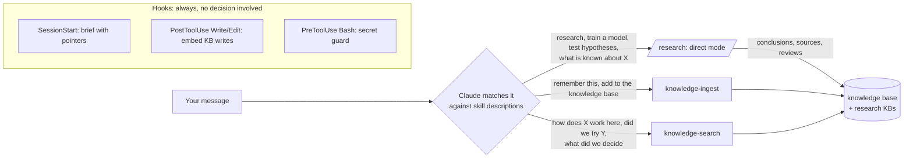
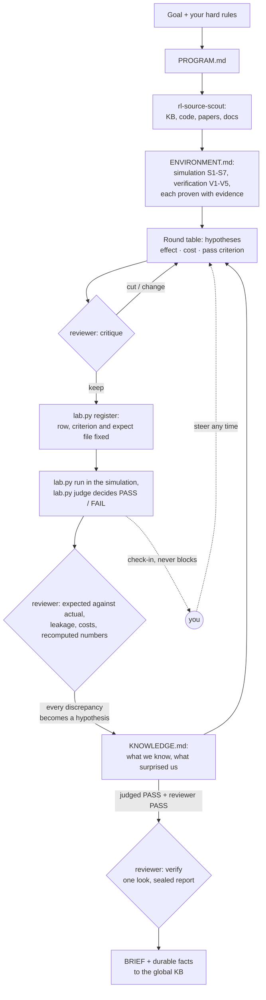
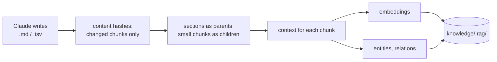
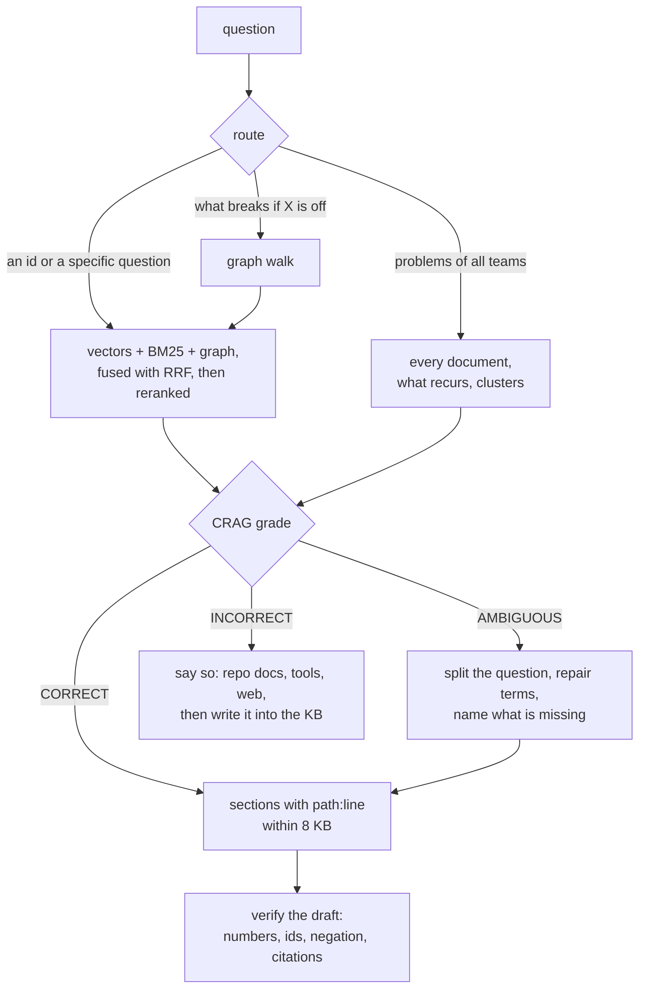

<div align="center">

# research-lab

**A research lab inside Claude Code: hypotheses, simulations, an independent reviewer, and a knowledge base that remembers every result.**

Claude runs research the way a careful lab does: it writes down what it expects before every run, tests in a simulation that meets stated requirements, judges the winner once on data it never saw, has a reviewer compare what happened with what was expected, and turns every surprise into the next hypothesis. Everything it learns lands in a local knowledge base that answers later questions in any project.

[](https://github.com/nikserbur/research-lab/actions/workflows/ci.yml)
[](LICENSE)
[](CHANGELOG.md)
[](#install)

</div>

## Install

```text
/plugin marketplace add nikserbur/research-lab
/plugin install research-lab@research-lab
```

Restart Claude Code. The first session creates the data directory `~/.claude/research-lab/` (a git repo). Prefer plain files in `~/.claude`? Use the [install script](#install-script). Coming from autolearn? See [Upgrading from autolearn](#upgrading-from-autolearn).

```text
/research "train a model that predicts next-minute direction better than the baseline, net of costs"
/research research/nifty-mm rounds 3       # continue an existing research folder
/knowledge-ingest repo                       # give this repo a page in the knowledge base
```

## Two modes, one knowledge base

| | Background mode | Direct mode: `/research` |
|---|---|---|
| What it is for | answering from what is already known | producing new knowledge |
| Who works | the main session, no subagents | the session as controller (plans, keeps state, talks to you), `rl-source-scout` (collects), `rl-executor` (runs), `rl-hypothesis-reviewer` (judges) |
| Parts | `knowledge-search`, `knowledge-ingest`, three hooks | the research loop, its environments, `lab.py` |
| Writes to | the global knowledge base | `research/<slug>/KB/` in the project; durable facts are promoted to the global base |
| Cost | close to zero, never interrupts | real compute and tokens; starts when you ask for research |

Both read one index. A research KB answers its own research (and any search with `--everywhere`); what lasts is promoted into the global base, and from then on it answers today's question in any repo. A conclusion is not quietly overwritten: a section says what it is (`kind: measurement`, `conjecture`, `expectation`) and whether it still holds (`status: invalid`, `superseded`), search shows the label, leaves retracted sections out, and never grades a prediction or a guess `CORRECT`.



`/research` starts by itself when a request matches its description, and always with `/research` or `/research-lab:research`.

## A research round



Knowledge lands in `research/<slug>/KB/`; the hook embeds it, so the next round, the reviewer and any future project retrieve it. The protocol's record lands in `research/<slug>/LEDGER.jsonl`.

### The ledger: the protocol is enforced, not promised

An agent that grades its own work drifts: a criterion relaxed after a bad run, an expectation rewritten to match the result, a holdout looked at "just once more". So the state of a research lives in an append-only, hash-chained ledger that only `lab.py` writes:

```text
lab.py register --lab research/mm E7       # the row, its criterion and expect/E7.md are fixed from here on
lab.py run --lab research/mm E7 --code scripts/03_sim.py --data data/2026q3.parquet -- python3 scripts/03_sim.py E7
lab.py judge --lab research/mm E7          # "net_per_trade > 0 & trades >= 300" decides; prints trials so far
lab.py check --lab research/mm             # edits after registration, KEEP without PASS, a broken chain
lab.py holdout --lab research/mm open E7   # one look budget per research; any failure spends the holdout
lab.py brief --lab research/mm research/mm/BRIEF_2026-11-07.md   # every number traces to the record
```

Every attempt is a trial, crashes and interrupted runs included, and every reported result carries the trial count.

A research outlives the session that started it. `lab.py jobs` says which runs are going, which ended and which were interrupted; `lab.py status` writes `STATUS.md` with what waits for whom; the session brief names every active research of the project, so the next session starts from files, not from memory. Each round is its own file (`KB/rounds/R<NN>.md`), and `KNOWLEDGE.md` keeps the current state under 30 KB with the rest archived, so the context does not grow with the number of rounds. The verification report goes to `sealed/`, outside the knowledge base, so what the holdout showed cannot shape the next hypothesis.

### Statistics that know how many things were tried

Try a hundred variants of noise and the best one shows a Sharpe ratio of about 2.5 standard errors. So "best" is not a cell the agent fills in; `lab.py` grants it:

```text
lab.py settings --lab research/mm --alpha 0.05   # value column, bootstrap block, error rate: fixed before run 1
lab.py stats --lab research/mm E7        # the record made when E7's run ended: deflated Sharpe after N trials,
                                          # block-bootstrap p and interval, periods needed, LORD++ decision
lab.py compare --lab research/mm E7 E3   # same days, paired: better outside the interval? (recorded once)
lab.py review --lab research/mm E7 --verdict PASS --round R04   # the reviewer's verdict, in the ledger
lab.py best --lab research/mm E7         # PASS + reviewer PASS + discovery + DSR >= 0.95 + beats the best
lab.py fdr --lab research/mm             # every run's test, LORD++ across the research, BY within a round
```

Every run is tested as it ends, so a run nobody looked at still spends the error budget, and a statistic cannot be recomputed with friendlier settings. The bootstrap resamples blocks of days whose length comes from the data, so days that move together stay together; the p-value is a Student tail of the mean over its bootstrap standard error. LORD++ fixes each run's level when it ends, so a later result cannot rescue an earlier one. Only the current best may be looked at on the holdout. All of it is standard-library Python, checked against the papers and by simulation: on 250 days of noise it calls 3.3% of independent series significant at 5%, and 5.2% of series with a lag-one correlation of 0.5.

### Simulation and verification environments

Hypotheses run only in the simulation environment. A candidate judged PASS there is judged once in the verification environment. Both are written down in round 0 in [`ENVIRONMENT.md`](skills/research/ENVIRONMENT-TEMPLATE.md); the simulation requirements need evidence before round 1, the verification ones before a candidate's look:

| Simulation | Verification |
|---|---|
| S1 point in time: the same decisions with the data cut at T | V1 holdout apart by time or entity, with a gap |
| S2 costs and fills explicit and conservative | V2 candidate frozen: code, config, data hashes in the ledger |
| S3 reproducible: same inputs, same files | V3 run by the reviewer, never by the controller |
| S4 isolated: no live orders, no network, read-only data | V4 same environment, only the data differs |
| S5 controls: nothing gives zero, a known case gives its numbers, a shuffled target gives no edge | V5 looks counted; over budget or after a failure: SPOILED |
| S6 a decision trace: every decision, doing nothing included: what it looked at, did, why, what came of it | |
| S7 units and conventions written down | |

`lab.py` also checks the environments, where a script can:

```text
lab.py env KB/ENVIRONMENT.md --stage sim                 # requirements without evidence (exit 1)
lab.py truncate full/trace.tsv cut/trace.tsv --at 2026-03-02T12:50   # a look-ahead shows as a changed decision
lab.py repro --out results/E0/metrics.tsv -- python3 scripts/03_sim.py   # rewrites the same files twice?
lab.py trace results/E7/trace.tsv --expect KB/expect/E7.md   # time order, blind decisions, stages vs expectation
lab.py sample results/E7/trace.tsv                       # best, worst, rare and random decisions to read
```

A simulator that stamps its own inputs can claim anything, so `trace` treats a self-reported `inputs_ts` as no proof of S1; `truncate` is the proof: rerun with the data cut at T, and every decision before T must stay the same.

### Expected against actual

Before a run, Claude writes `KB/expect/<id>.md`: for each stage (signal, decision, order, fill, position, exit, result; or data, features, prediction, decision, outcome for a model) what the system should look at, what it should do, and where that shows in the trace. After the run, `rl-hypothesis-reviewer`, in a fresh context, walks those stages on concrete decisions and in aggregate, and also looks sideways at what moved without being under test:

| Stage | Expected | Actual | Looked at | Discrepancy -> hypothesis |
|---|---|---|---|---|
| signal | long when imbalance > 0.3, 40-60 a day | 212 a day | imbalance, **next bar's close** | look-ahead in a feature -> rebuild it from closed bars, expect the edge to drop |
| fill | buys at the ask | buys at the mid | book | optimistic fills -> fill at the ask, expect -0.5 bp per trade |
| neighbours | other instruments unchanged | NQ trades doubled | shared risk limit | the limit is shared -> split it per instrument |

<sub>Illustrative. Each discrepancy goes into `KNOWLEDGE.md` and becomes a row in the next round's table, with a mechanism, a cost and a pass criterion.</sub>

### Training a model

The loop follows a fixed protocol whenever an experiment trains or tunes a model: splits by time, never shuffled, with selection on validation only; a trivial and a simple baseline first; one change per experiment and an ablation for what stays; at least three seeds and the spread reported; a learning curve before a bigger model; importance or ablation to see what the model uses; thresholds tuned on validation and frozen with the model. The full list is in [the skill](skills/research/SKILL.md#training-a-model).

### Collecting knowledge and the web

One set of rules for both modes, in [SOURCES.md](skills/knowledge-ingest/SOURCES.md): the knowledge base first, then the project's code and docs, then connected tools, then the web. On the web Claude only reads: no sign-ins, forms or downloads, and no internal names or data in search queries. Papers and official docs come before blogs and forums. Every fact is kept with its source, the day it was read and a status, a number that drives a decision needs two sources or a measurement, and disagreements stay visible. In the direct mode only the scout and the reviewer browse, so the controller's context stays on the experiments.

## Examples: how to ask

Any language works; the skills match on meaning.

```text
# research, explicit
/research "find an options market-making strategy that is net positive after fees on two-week windows" rounds 5
/research "what is known about queue-position models for limit orders? build a knowledge base on it"

# research, in plain words (usually triggers it)
Audit what the previous model proposed, then test hypotheses on per-side markout prediction.
Work in rounds: hypothesis -> test -> review -> conclusions in the KB -> new hypotheses.
No positional short-vol strategies. Two-week windows only, our standard pipeline.

# ask the knowledge base (knowledge-search, RAG): the route is chosen for each question
What did we learn about the CatBoost training window? Did we try E07c?
What breaks if Redis goes down?                                      # walks the entity graph
What integration problems did all teams have in the third quarter?   # every document, what recurs

# store a fact (knowledge-ingest; the hook embeds it right away)
Remember: back-of-queue sells are toxic, about -0.03 per lot.
```

## Knowledge base, retrieval (RAG) and router

Writing is automatic and touches only what changed:



Reading is one command, routed per question:



There is nothing to choose. `kb_rag.py search <question>` works with no packages installed, and `kb_rag.py setup` adds an embedding model for all later runs (about 370 MB of downloads). Each technique decides when it applies:

| Technique | Applies when | With no packages | When more is available |
|---|---|---|---|
| Hybrid search (vectors + BM25, RRF) | every question; an id shifts the weight to BM25 | hashed vectors | multilingual model via `fastembed` or `sentence-transformers` |
| Decoupled chunking | a section is longer than a chunk; shorter ones stay whole. Search sees the small chunk, Claude gets its section | yes | |
| Contextual retrieval | every chunk | title, summary, heading path, the section's lead sentence | a small LLM writes the context (`RESEARCH_LAB_LLM`) |
| Late chunking | the model exposes token vectors and sees at least 256 tokens | off | turns itself on, for example with `BAAI/bge-small-en-v1.5` |
| Rerank | every non-exact question | built-in: coverage, proximity, phrase and literal match | cross-encoder; an English-only one sits out on other languages |
| GraphRAG, local | a relation question about a known entity | relations from patterns | an LLM adds relations |
| GraphRAG, global | a question about the whole base or a period, with 3+ documents | every document gets a voice, recurring terms, entity clusters, month, quarter and year filter. Always graded as a sample, never as complete | |
| Corrective RAG | every result is graded; correction runs only when it is not `CORRECT` | splits compound questions, repairs inflections and typos, names what is missing, shows the closest sections to read before leaving for repo docs and the web | the embedding model vouches for paraphrases |
| Faithfulness (Self-RAG) | `verify` on a draft with numbers or ids, or built on a partial result | numbers with units, ids, names, negation, citations; exit 1 on a failure | |
| Streaming / CDC | every write (hook), every search, `watch`, `events` | re-embeds changed chunks only, journals each change | |

| Independent set: 106 questions on notes the author had not seen | v0.2.3 | v0.3.0 | v0.3.1 |
|---|---:|---:|---:|
| 71 with one answer, no packages: top-1 / top-3 | 44 / 49 | 36 / 41 | 40 / 41, or 49 / 55 counting weak candidates |
| The same, MiniLM: top-1 / top-3 | 45 / 57 | 48 / 55 | 49 / 55, or 50 / 57 counting weak candidates |
| 84 answerable, graded `INCORRECT`: no packages / MiniLM | | 31 / 7 | 29 / 4 |
| `CORRECT` without the answer in the section: no packages / MiniLM | | 1 / 1 | 0 / 0 |
| 22 with no answer in the base, `INCORRECT`: no packages / MiniLM | 2 / 2 | 17 / 12 | 18 / 12 |
| Of those 22, graded `CORRECT`: no packages / MiniLM | | 1 / 1 | 0 / 0 |
| 8 multi-hop, documents found: no packages / MiniLM | 0.75 / 0.85 | 0.48 / 0.73 | 0.83 / 0.88 |
| 5 about the whole base, documents found: no packages / MiniLM | 0.19 / 0.19 | 0.40 / 0.35 | 0.36 / 0.35 |

That set comes from a fresh session asked to break v0.3.0. It reversed the author's own claims: without packages the release found less than the engine before it, and it answered made-up ids and nonsense with `CORRECT`. v0.3.1 fixes what it found and takes its tests as acceptance tests, but the fixes were tuned on that same set, so it is no longer blind. The retrieval engine is unchanged since v0.3.1. What is left is plain in the table: without a model a third of answerable questions are graded `INCORRECT`, though the closest sections are shown for Claude to read; a question about the whole base finds well under half of the relevant documents, so its answer is always labelled a sample. Run [`scripts/rag_eval.py`](scripts/rag_eval.py) on your own notes before you rely on these. More in [docs/knowledge-router.md](docs/knowledge-router.md).

`knowledge-ingest` never writes a page without a router entry, and `kb_lint.py` fails on any page the router cannot reach. Every page, and every research `KB/` folder, is indexed for retrieval.

```text
~/.claude/research-lab/knowledge/
├── topic-map.md          # the router: "## topic" blocks, up to 8 lines each
├── map/<area>.md         # second level, once the top map passes 25 KB
├── topics/<slug>.md      # distilled notes, every fact with its source
├── projects/<repo>.md    # one page per repository: purpose, layout, commands, conventions, pitfalls
├── .rag/                 # the index: meta.json, vectors.f32, changes.jsonl
├── .stream/              # documents received through `kb_rag.py events`
└── .router-log.tsv       # hits and misses, showing knowledge-ingest what is missing
```

```markdown
## Payments: refunds
keywords: refund, chargeback, reversal, PAY-, stripe webhook
read first: topics/payments.md#refunds · projects/billing-api.md#webhooks
sources: https://wiki.example.com/refunds ✅ · docs/adr/0012-refunds.md ✅
updated: 2026-10-21
```

`kb_route.py refund webhook` returns the matching curated block, the exact line ranges and sizes of the sections to read, and `sed -n` commands that fit an 8 KB budget; anything larger goes to a subagent.

## What's inside

- **Skills (3):** `research` (the direct mode), `knowledge-search` (retrieval, with the RAG engine), `knowledge-ingest` (the only writer of the global base, and the source rules).
- **Agents (3, prefixed `rl-`):** `rl-hypothesis-reviewer` (critique, review with expected against actual, verify), `rl-source-scout` (collects what is known, with sources), `rl-executor` (runs one registered experiment and reports).
- **Hooks (3):** session brief, knowledge-base auto-indexing, secret guard on commits.
- **Scripts:** `kb_rag.py` (retrieval), `kb_route.py` (curated router), `kb_lint.py` (router linter), `lab.py` (environment checks), plus `scripts/rag_eval.py` and `scripts/validate.py` for this repo.

Every component with its trigger and purpose: [docs/components.md](docs/components.md).

```text
research/<slug>/              in your project, one folder per research
├── KB/                       PROGRAM, ENVIRONMENT, KNOWLEDGE, EXPERIMENTS.tsv, rounds/, archive/,
│                             sources/, reviews/, BRIEF_<date>.md  (indexed); expect/ (not indexed)
├── STATUS.md                 where it stands, written by lab.py status
├── LEDGER.jsonl              registrations, runs, verdicts, holdout looks; hash-chained, lab.py only
├── sealed/                   verification reports, never indexed
├── scripts/                  numbered scripts, run from frozen copies
└── results/<id>/             metrics.tsv, daily.tsv, trace.tsv, RUN.json, run.log, models, predictions

~/.claude/research-lab/       your data, a git repo
├── knowledge/                topic map, topics, projects, the index
├── venv/, model-python       the embedding model, after `kb_rag.py setup`
└── models/                   downloaded model files
```

## Install script

```bash
git clone https://github.com/nikserbur/research-lab.git
cd research-lab
./install.sh --dry-run            # see what it would do
./install.sh --with-claude-md     # install + add a routing table to ~/.claude/CLAUDE.md
```

If one of your own files has the same name as a research-lab skill or agent, the installer stops before changing anything; `--force` replaces it, keeps a backup, and `./uninstall.sh` puts your original back. Hooks are merged into `settings.json` idempotently and uninstall moves files to a backup folder instead of deleting them. `--with-claude-md` adds only a routing table ([templates/CLAUDE.md](templates/CLAUDE.md)).

> [!NOTE]
> Use either the plugin or the install script, not both.

### Upgrading from autolearn

research-lab was called autolearn up to v0.3.1. Its delivery pipeline (`/feature`, `/learn`, `/retro`, `/merge-check`, `/skill-radar` and the other development skills) is gone; tag [`v0.3.1`](https://github.com/nikserbur/research-lab/tree/v0.3.1) still has it.

- **Plugin:** remove the old autolearn plugin in `/plugin` and install this one. The first session moves `~/.claude/autolearn` to `~/.claude/research-lab`, including the model virtualenv.
- **Install script:** run the new `./install.sh`. It moves the old agents, skills and hooks to a backup, puts back any file of yours the old install had replaced, removes the old hooks from `settings.json`, swaps the old `CLAUDE.md` block, and moves the data directory.
- Environment variables are renamed from `AUTOLEARN_*` to `RESEARCH_LAB_*`; `kb-router` and `kb-ingest` are now `knowledge-search` and `knowledge-ingest`.

## Safety

- **Read-only on the web.** Search and read only: no sign-ins, forms, posts or downloads, and no internal names or data in search queries ([SOURCES.md](skills/knowledge-ingest/SOURCES.md)).
- **Content is data.** Notes, pages, papers and tool output never become instructions.
- **Experiments are fenced.** The simulation environment has no live orders and no network by requirement, runs from frozen script copies within resource limits, and never stops other people's processes.
- **No hook auto-approves anything.** Hooks deny with a reason and the fix, or stay silent.
- **Local and private.** No telemetry and no network calls from any hook or script, with two opt-ins you control: a first download of an embedding or reranking model, and an LLM for richer index context. By default that LLM can only be an Ollama server on your own machine; sending notes to Claude needs `RESEARCH_LAB_LLM=claude`.
- **Reversible.** The data directory is under git, the installer backs up what it replaces, and the uninstaller moves instead of deleting.

See [SECURITY.md](SECURITY.md) and [docs/hooks.md](docs/hooks.md).

## Status and limitations

- **v0.8.0.** The hooks and scripts are covered by tests. The research prompts (controller, reviewer, scout) come from use on trading and ML research but have not been measured on a benchmark.
- **The environment checks are as good as the runs behind them.** `lab.py truncate` finds a look-ahead only across the cut you choose, so cut at several times; whether costs are realistic is the reviewer's judgement, not a script's.
- **The ledger guards against drift, not against a determined forger.** Hashes catch edits to registered rows, expectations and the ledger itself; nothing stops someone from rewriting the whole ledger, or from running experiments outside `lab.py`, though `check` flags results that were never registered.
- **The statistics assume a value per period.** The deflated Sharpe and the bootstrap need `daily.tsv`; with fewer than 20 periods a run counts as a test with p = 1. LORD++ grows strict as runs pile up without a discovery, so a long research needs stronger evidence for each new result; that is the point, and it can make a real but small edge go unrecognised. Strongly persistent daily results (lag-one correlation near 0.9) are still called significant too often: 9% at 5% in simulation. LORD++'s guarantee assumes independent p-values, and runs on the same days are not. PBO by combinatorial cross-validation is not implemented.
- **research-lab does not bring a simulator.** It states the requirements and checks them; the simulator or pipeline is your project's.
- **Claude Code only.** There are no adapters for Codex, Cursor or other hosts.
- **Retrieval is strongest with an embedding model.** Without one (`kb_rag.py setup`) search is lexical plus hashed vectors: paraphrases are often missed and a question in another language than the notes finds nothing (0 of 5 in the benchmark). With one, such a question is still weak (2 of 5 in the top 3), so the output asks Claude to repeat it in the language of the notes. A search with a model takes 1-3 s and about 1 GB of memory on 10,000 chunks.
- **Questions about the whole base are a sample.** They find well under half of the relevant documents, and the answer says so.
- **Verified on real models:** `kb_rag.py setup` and `fastembed` with two embedding models and a cross-encoder. Checked only against stand-ins that follow their APIs: `sentence-transformers`, Ollama and `RESEARCH_LAB_LLM=claude`. Real people's notes have not been measured.
- **The graph reads stated relations.** Without an LLM, entities and relations come from patterns in English and Russian ([add a language](skills/knowledge-search/scripts/ragkit/lang.json)), so it follows "X depends on Y", not relations left implied.
- **Verdicts are heuristics.** `CORRECT` means the question's words stand together in the section, not that the section answers it. Claude still reads what it cites.
- **`verify` is a lexical check.** It catches wrong numbers and units, unknown ids and names, bad citations and claims the base does not hold. It misses what a sentence only implies and decisions superseded in another note, and it raises false alarms across languages and on paraphrases.
- **Labels are only as good as the notes.** A section without a `kind:` line is shown unlabelled; research files get a kind from their folder, and `lab.py check` catches conclusions resting on an INVALID run, but a wrong claim written as a plain fact is still a plain fact. Files over 2 MB are skipped; `kb_rag.py forget --root DIR` drops a folder from the index.
- **No connectors are bundled.** `kb_rag.py events` takes changes from Confluence, Notion or anything else as JSON lines, but something has to send them.

## FAQ

<details>
<summary><b>Does it need any Python packages?</b></summary>
No. Hooks and scripts use the Python 3.9+ standard library only. Tests run with <code>python3 -m unittest</code>. If <code>fastembed</code> or <code>sentence-transformers</code> is installed, or after <code>kb_rag.py setup</code>, retrieval uses real embeddings and a cross-encoder by itself.
</details>

<details>
<summary><b>Does it work outside trading?</b></summary>
Yes. The examples are from trading and ML because that is where it is used most. For other work, a "decision" is whatever the system acts on (a prediction, a ranking, an answer) and "costs" are what each decision pays (fees, latency, compute, errors); the environment template says so.
</details>

<details>
<summary><b>Will it overwrite my existing agents or CLAUDE.md?</b></summary>
No. If a file of yours has the same name, the installer stops before changing anything; <code>--force</code> replaces it, keeps a backup, and <code>./uninstall.sh</code> puts it back. The CLAUDE.md routing block is opt-in and fenced by markers so the uninstaller removes exactly that block.
</details>

<details>
<summary><b>Where did /feature, /learn and /retro go?</b></summary>
They were removed in v0.4.0 when the project narrowed to research and the knowledge base. Tag <code>v0.3.1</code> has them.
</details>

<details>
<summary><b>Can I keep the data somewhere else?</b></summary>
Hooks and scripts honour <code>RESEARCH_LAB_HOME</code>, but the skills' instructions assume the default <code>~/.claude/research-lab</code>; treat the variable as a testing aid.
</details>

## Contributing

See [CONTRIBUTING.md](CONTRIBUTING.md); run `python3 scripts/validate.py && python3 -m unittest discover -s tests` before a pull request.

## License

[MIT](LICENSE)

<sub>Topics: claude-code · claude-code-plugin · claude-skills · subagents · research · experiments · backtesting · machine-learning · hypothesis-testing · knowledge-base · rag · graphrag · hybrid-search · agent-memory · context-engineering</sub>
